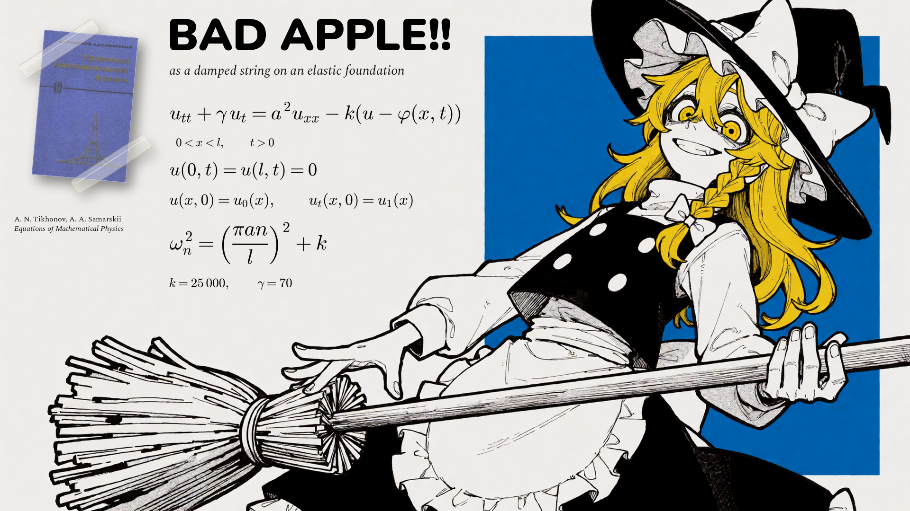

# BadString

[](ASSETS.md)



BadString turns a black-and-white video into an animation of two strings that vibrate. It includes renders of Bad Apple!! and small string experiments

## Mathematical model

Each string follows a damped wave equation on the normalized interval $0 \leq x \leq 1$

$u_{tt} = u_{xx} - \gamma u_t + k(f-u)$

Here $u(x,t)$ is the string displacement from the vertical center of the image, $f(x,t)$ is its target contour, $k$ is the spring stiffness, and $\gamma$ is the damping coefficient

The ends satisfy Dirichlet conditions $u(0,t)=u(1,t)=0$. Each string starts at its contour in the first frame with zero velocity

The program extracts the upper and lower contours from each frame. It holds each target until the next update and pulls the corresponding string toward it. A uniform background column has its target at the image center

The solver expands each string in a finite sine basis. It solves each damped mode exactly between target updates; the basis also keeps both ends fixed. The parameters are in [`bad_apple.py`](bad_apple.py)

## Requirements

Use Python, FFmpeg, NumPy, Matplotlib and Pillow

```bash
python -m pip install numpy matplotlib pillow
```

## Run

Provide a video file with an audio track for export. The original source video is not included in the repository

```bash
python bad_apple.py path/to/video.mp4
python bad_apple.py path/to/video.mp4 --export output.mp4
```

Run the circle experiments with `python circle_reset.py`, `python circle_spring.py` or `python circle_impulse.py`

## Tests

```bash
python -m unittest -v
```
